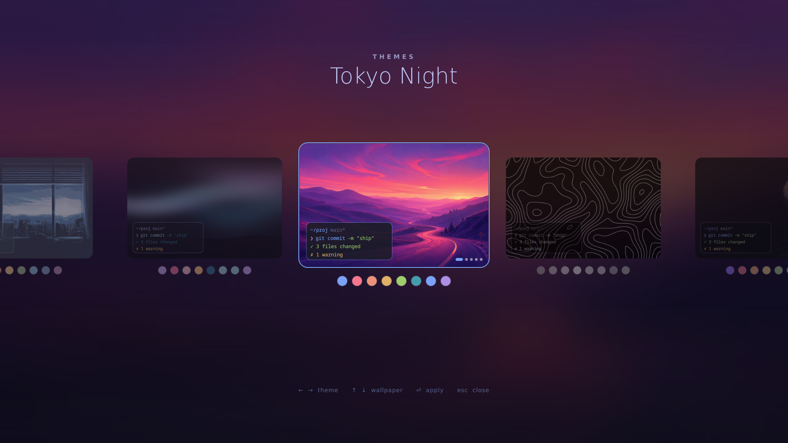
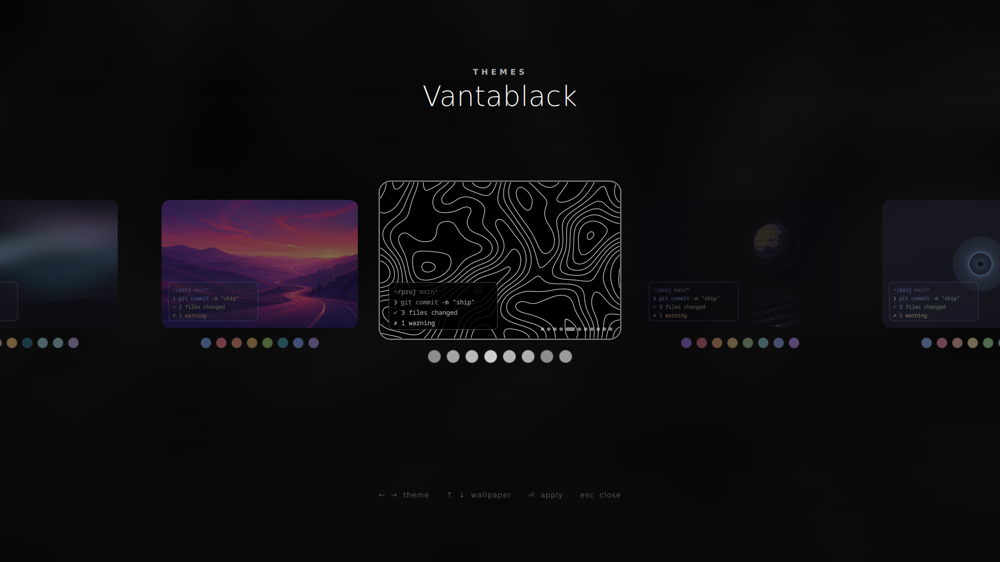

# plasma-themer

Omarchy-style, one-keystroke theme switching for KDE Plasma 6 (Wayland). One palette per theme drives the
whole desktop: Plasma, terminals, shell, browser, editor, chat, notes and the login screen.

It also themes an **LXQt + labwc** Wayland session next to Plasma, with the same keys and picker. For a
lightweight session that feels like Plasma (shortcuts, gestures, OSD, tray popups), see
[labwc-plasma-session](https://github.com/envy-vain/labwc-plasma-session).



Themes: **Tokyo Night · Matte Black · Catppuccin Mocha · Rosé Pine · Gruvbox · Everforest · Nord · Kanagawa ·
Cachy Night · Ethereal · Last Horizon · Vantablack**

Palettes and most wallpapers come from [Omarchy](https://github.com/basecamp/omarchy) (MIT), as does the template
for the generated VSCodium theme. Rosé Pine uses the dark "main" palette. **Cachy Night** is original: near-black,
violet accent, warm gold, Nord-ish terminal colors. Most themes also ship generated wallpapers (`gen-*`); `tools/genwall.py` makes more for any theme.



## Install

Any distro with **KDE Plasma 6** and Python 3.11+: Arch/CachyOS/EndeavourOS/Manjaro, Fedora KDE,
Kubuntu/KDE neon/Debian, openSUSE.

```
git clone https://github.com/envy-vain/plasma-themer ~/.local/share/plasma-themer-src
~/.local/share/plasma-themer-src/install.sh          # add --no-system to skip anything needing sudo
```

The installer backs up your configs first, takes btrfs snapshots if your system supports them, installs
what your distro packages (falling back to Flatpak / pip / upstream releases for the rest), and skips whatever
isn't available. The login screen is themed on Plasma Login Manager and SDDM (Breeze). Firefox, VSCodium and
Vesktop are found whether installed natively, as a Snap (Firefox) or as a Flatpak.

## Keys

| Keys | Action |
|---|---|
| `Super+Ctrl+Shift+Space` | Overlay picker (←/→ theme, ↑/↓ wallpaper, Enter apply, Esc close, 1–8 jump) |
| `Super+Ctrl+Space` | Next wallpaper in the current theme |
| `Super+Ctrl+Alt+Space` | Next theme |

## CLI

```
themer list | pick | set <theme> | next | prev | current | reapply
themer bg [next|prev]
themer set nord --only konsole firefox     # run only some integrations
themer setup                               # hotkeys, VSCodium theme extensions, Pywalfox host
themer doctor                              # what's installed / wired up
themer lite on|off|auto                    # lite mode for weak PCs (default: auto)
```

## Weak hardware

Built to stay light:

- **Wallpapers are scaled to your screen once** and cached (`~/.cache/plasma-themer/wallpapers`). Upstream
  wallpapers go up to 7680 px; Plasma, the lock screen and the login screen now load a screen-sized JPEG.
- **The picker uses no shader effects.** Rounded cards and the blurred backdrop are pre-baked images
  (`themer setup` bakes them on all cores), so it runs on weak iGPUs and, with no GPU, on Qt's software renderer.
- **Nothing re-applies needlessly.** The color scheme and icon theme are skipped when unchanged (both make every
  app repaint), files are only rewritten when their content changes, Konsole is driven over in-process D-Bus,
  and the slow Electron CLI of VSCodium is never started during a switch.
- **Instant picker.** A small user service (`plasma-themer-picker.service`, ~50 MB) keeps the picker loaded but
  hidden; the hotkey drops a file that it notices through inotify (no polling) and it appears in ~150 ms. Without
  the service the hotkey runs a tiny shell launcher straight into Qt with pre-built data (~0.65 s, no Python).
  Turn it off with `systemctl --user disable --now plasma-themer-picker`.
- **Lite mode** (auto-on with no GPU, ≤2 CPU cores or <4 GB RAM) drops picker animations and translucency and
  makes Konsole opaque without blur. Force it with `themer lite on`.

## What switches

| Target | How |
|---|---|
| Plasma colors + accent | generated `.colors`, alternating ids so KDE always reloads |
| Wallpaper + lock screen | `plasma-apply-wallpaperimage`, `kscreenlockerrc` |
| Login screen | Plasma Login Manager / SDDM Breeze read files in the user-owned `/var/lib/plasma-themer` |
| Cursor | Bibata (Ice / Amber / Classic per theme) |
| Icons | Breeze Dark (monochrome, follows the theme colors) + black folders with pastel accents (per-user overlay, `/usr` untouched) |
| GTK apps | follow the Plasma scheme automatically |
| Konsole | generated colorscheme, live-switched over D-Bus in every open session |
| Alacritty | imported theme file, live reload |
| fish | universal `fish_color_*` + Pure prompt colors (live in every shell), fzf, `BAT_THEME=ansi` |
| btop · tmux · vim · fastfetch | generated theme files, live where the app supports it |
| Firefox | Pywalfox for live UI colors + `userChrome.css`/`userContent.css` for shape, new-tab page, about: pages |
| VSCodium | `workbench.colorTheme`; themes without a published one get a theme generated from the palette |
| Vesktop | `themes/plasma-themer.css` (hot reload) |
| Obsidian | CSS snippet in every vault (hot reload) |
| LXQt + labwc | panel, runner, notification and settings stylesheets, LXQt palette, labwc window borders + menus, `swaybg` wallpaper; Konsole gets an opaque profile there (labwc has no blur) |

Known limit: Dolphin windows that are already open keep their old folder colors until you change folder or
reopen them (KDE doesn't redraw them); everything else updates live.

## Adding a theme

`themes/<slug>/colors.toml` (same keys as Omarchy), `theme.toml` (`name`, `cursor`, `folders`),
optional `vscode.json` and `backgrounds/`. Personal themes can live in `~/.config/plasma-themer/themes/`.
`tools/genwall.py <slug> --style waves|aurora|dunes|ascii` paints matching wallpapers from the palette.

## Undo

- `install/restore.sh` puts every config back from the pre-install backup
  (`~/.local/share/plasma-themer/backups/`) and removes hotkeys + icon overlay.
- `konsave -a pre-plasma-themer` restores the KDE look.
- btrfs: snapper snapshot "pre plasma-themer" for `/`, read-only snapshot in `/home/.snapshots-themer/`.
- Login screen: `sudo cp /etc/plasmalogin.conf.pre-themer /etc/plasmalogin.conf` (Plasma Login Manager), or
  `sudo rm /usr/share/sddm/themes/breeze/theme.conf.user` (SDDM; `restore.sh` prints the exact commands).

## About

I wrote the base of this project (the code that does the theming); the front end (the picker UI) was designed by Claude.

**LLM disclaimer:** an LLM (Claude, by Anthropic) designed the picker UI and helped polish the project.
Everything is tested on my own machine and I use it daily.
